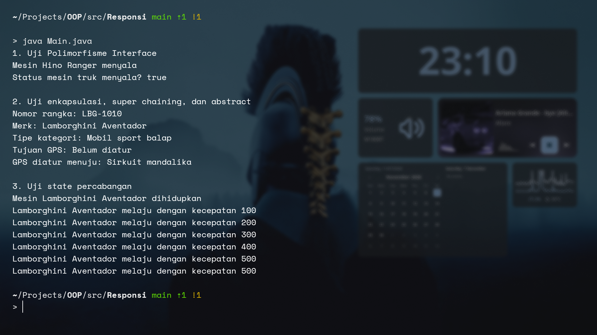

# RESPONSI AKHIR PRAKTIKUM PBO - PAKET OTOMOTIF

* **Nama:** Mufaddhol

* **NIM:** H1D025069

## STRUKTUR DIREKTORY

```
.src/Responsi
├── kendaraan.java
├── kontrolMesin.java
├── Main.java
├── mobilSport.java
├── navigasi.java
├── screenshot
│   └── output.png
└── trukKargo.java

2 directories, 7 files

```

## COMPILE

## Linux (arch)

Install jdk:

```
sudo pacman -S jdk-openjdk
```

run:

```
java Main.java
```

### Windows (cmd/powershell):

```
java Main.java
```

## SCREENSHOT OUTPUT

